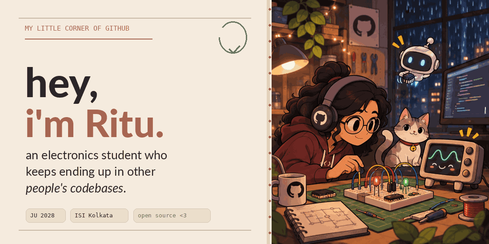
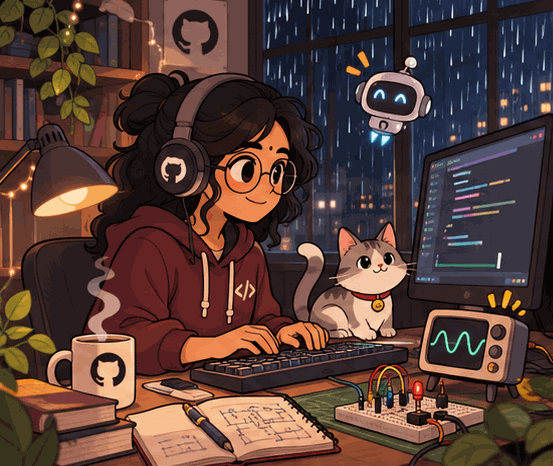
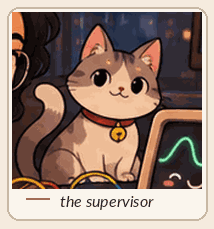
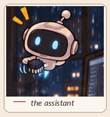
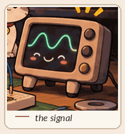
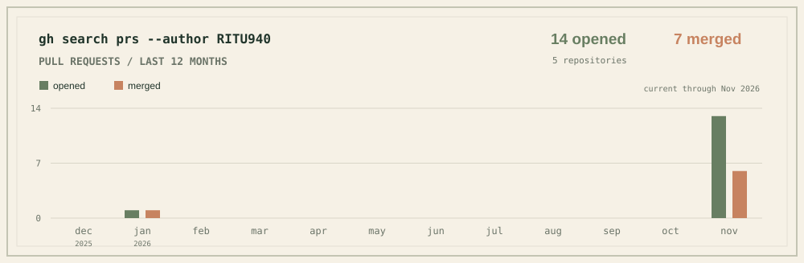
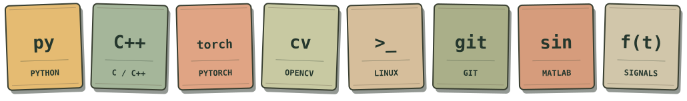

<div align="center">
  
  <br><br>
  <samp>electronics & telecommunication @ Jadavpur University · research · open source · occasional soldering disasters</samp>
  <br><br>
  <a href="https://github.com/RITU940?tab=repositories">my repositories</a> &nbsp;·&nbsp;
  <a href="https://github.com/search?q=is%3Apr+author%3ARITU940&type=pullrequests">my pull requests</a> &nbsp;·&nbsp;
  <a href="https://www.linkedin.com/in/ritu94/">linkedin</a> &nbsp;·&nbsp;
  <a href="mailto:baskeyritu@gmail.com">say hello</a>
</div>

---



### hi, you've found my workbench. ☕

I'm **Ritu**, an Electronics & Telecommunication Engineering undergraduate at **Jadavpur University** (2028). Most of the time I'm somewhere between a notebook full of equations and a terminal full of compiler errors.

I got into software through computer vision and research, but lately the most interesting problems have been the ones hiding in the *implementation*: an image border that behaves differently under SIMD, a raster comparison that passes when it shouldn't, or a test that looks convincing until you check its assumptions.

At **ISI Kolkata's CVPR Unit**, I worked on scene-text recognition for low-resource Indic scripts, including **Florence-2 / LoRA**, grapheme-aware evaluation, and carefully tracked experiments. The part I value most is learning to make a result reproducible—not just exciting in a screenshot.

These days I gravitate toward **OpenCV, GRASS GIS, GNU Radio**, signal processing, optimization, control systems, and the occasional completely unrelated side project. I still think getting a stubborn little circuit to work is one of life's better feelings.

<br clear="right" />

### the little desk crew ᓚᘏᗢ

<div align="center">
  
  
  
  <br>
  <sub>one supervises · one helps · one insists the waveform looks fine</sub>
</div>

### patches, not just pixels 🔧

I like open source because a patch has to survive other people's machines, tests, and review comments. Here are some places I've been learning in public:

| upstream | the rabbit hole |
| :--- | :--- |
| **[GRASS GIS](https://github.com/OSGeo/grass)** | [r.mapcalc test semantics](https://github.com/OSGeo/grass/pull/8192), [r.mfilter boundary documentation](https://github.com/OSGeo/grass/pull/8240), and other raster/vector edge cases. |
| **[OpenCV](https://github.com/opencv/opencv)** | Border handling, image warps, small deterministic reproducers, and regression testing. [See my PRs](https://github.com/opencv/opencv/pulls?q=is%3Apr+author%3ARITU940). |
| **[GNU Radio](https://github.com/gnuradio/gnuradio)** | Digital communications examples and verification-oriented tests. [See my PRs](https://github.com/gnuradio/gnuradio/pulls?q=is%3Apr+author%3ARITU940). |

I don't count an open PR as a merged PR. Here's the actual trail, fetched from GitHub automatically:

<div align="center">
  
  <br>
  <sub>12-month PR history · opens and merges counted separately · <a href="https://github.com/search?q=is%3Apr+author%3ARITU940&type=pullrequests">view the source PRs</a> · <a href="https://github.com/RITU940/RITU940/actions/workflows/update-pr-graph.yml">update workflow</a></sub>
</div>

### some things i've built (and actually worked on)

| project | what you'll find inside |
| :--- | :--- |
| **[SENTINEL](https://github.com/RITU940/innovent)** | An offline aircraft-inspection prototype built around PatchCore anomaly detection. The anomaly module works; the reasoning and manual-grounding pieces are still being built. |
| **[gateway](https://github.com/RITU940/gateway)** | A zero-trust enforcement gateway for autonomous agents: scoped tokens, Ed25519-signed actions, policy checks, budgets, and audit trails. |
| **[Water-network digital twin](https://github.com/RITU940/wash-challenge)** | Hydraulic simulation, leak/burst scenarios, and Isolation Forest anomaly detection in a monitoring dashboard. |
| **[Traffic demand forecasting](https://github.com/RITU940/flipkart_grid)** | Geohash and time-based feature engineering, careful validation, and an ensemble of tree-based models. |

<details>
<summary><b>my four research notebooks (very much works in progress)</b></summary>

<br>

- **[Safe control](https://github.com/RITU940/independent-research-safe-control)** — control under uncertainty, LQR and constrained feedback baselines.
- **[Optimization](https://github.com/RITU940/independent-research-optimization)** — numerical algorithms and honest evaluations under computational constraints.
- **[Signals & inverse problems](https://github.com/RITU940/independent-research-signal-inverse)** — recovering signals from noisy or incomplete measurements.
- **[Remote sensing](https://github.com/RITU940/independent-research-remote-sensing)** — satellite time series, change detection, and what goes wrong when seasons get in the way.

These are independent learning/research workspaces, not claims of published discoveries. I keep them reproducible so I can test the interesting questions properly.

</details>

### things i reach for when something breaks

<div align="center">
  
</div>

```text
languages       Python · C/C++ · MATLAB · JavaScript
research        PyTorch · OpenCV · NumPy · scikit-learn
systems         Linux/WSL · Git · CMake · pytest · GitHub Actions
also           geospatial tools · React/Next.js · signal processing
```

<details>
<summary><b>a few things not in the terminal...</b></summary>

<br>

I also enjoy building things that move. Our JUMSC RC car **Highway to Hell** won the *Lowest Cost* category. Hardware is a very good way to discover that the real world doesn't read your README.

And yes, I have a weakness for making side projects more elaborate than they needed to be. :)

</details>

---

<div align="center">
  <samp>if you've found a bug in my code, found something interesting to collaborate on, or just want to talk engineering, i'm around.</samp>
  <br><br>
  <a href="mailto:baskeyritu@gmail.com">email me</a> &nbsp;·&nbsp;
  <a href="https://www.linkedin.com/in/ritu94/">linkedin</a> &nbsp;·&nbsp;
  <a href="https://github.com/RITU940">github</a>
  <br><br>
  <sub>made for this little corner of GitHub, with plenty of room to keep growing ✿</sub>
</div>
